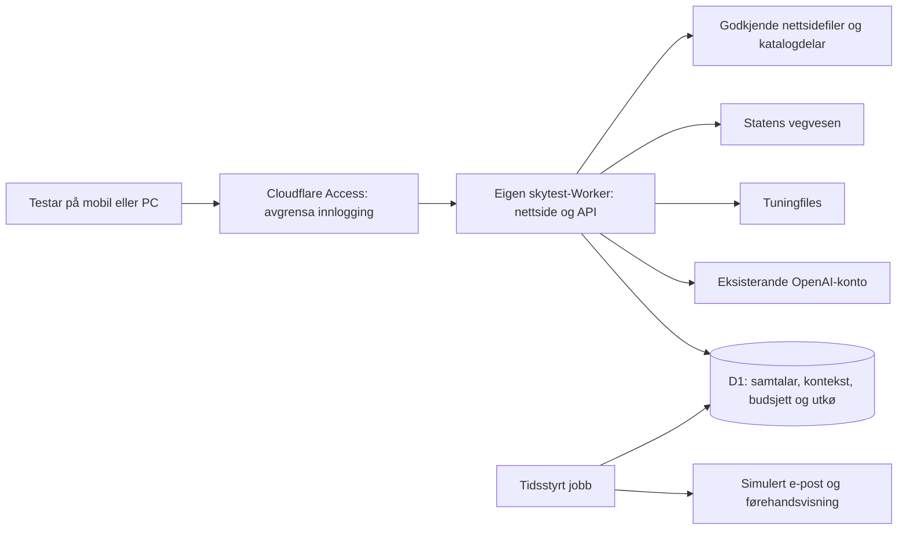

# Privat skytest – undersøkt 9. november 2026

Oppdatert: **den private skytesten er aktiv på https://skytest.tuningservicevest.no/**, verna med e-postkode og berre den godkjende testaren. EU-D1, servernøklar, ekte AI, oppslag og fast Mailjet-mottakar er konfigurerte. Sjå [gjeldande aktiverings- og teststatus](ACTIVATION.md). Undersøkinga nedanfor er historisk og skildrar utgangspunktet før opprettinga. Produksjon er urørt.

## Konkret løysing

Bruk ein **eigen Cloudflare Worker med Static Assets, D1 og ein tidsstyrt jobb**, på same konto. Føreslått namn er `tuningservicevest-skytest`; eventuell adresse `skytest.tuningservicevest.no` er eit forslag, ikkje ei aktiv adresse. Dagens Pages-prosjekt og delte e-postworker blir bevarte.



Ein Worker med eiga testadresse samlar alle API-ar og nettlesarfiler under same opphav. Cloudflare Access må verne HTML, katalogfiler og API. `run_worker_first=true` og serverkontroll av signert Access-JWT skal gi avvising ved manglande/feil tilgangsoppsett, ikkje offentleg fallback. `workers.dev` og alternative preview-adresser skal vere av, og eigne samtaletoken skal hindre innsyn i andre testar sine samtalar. Administrasjon treng eiga tilgangsliste.

Dette er meir eigna for denne testen enn å slå på ein vanleg branch-preview i eksisterande Pages: repoet er offentleg, preview er offentleg som standard, og alle ikkje-produksjonsbrancher er valde for automatisk preview. Ei nettside bak Access gjer ikkje ein offentleg GitHub-branch privat. Pakka kan seinare lastast direkte opp; katalogen, nøklar og private testdata skal ikkje leggjast i det offentlege repoet.

## Stadfesta i konto og GitHub i dag

| Del | Funn |
|---|---|
| Produksjon | Pages `tuningservicevest-no`, repo `tuningservice/tuningservicevest.no`, `main`, aktiv utrulling `1e3b28f22f4996d2bb41b9245ebc90ef6d8c96e6` |
| Kjeldegrunnlag | `main` er fire commit framfor arbeidskopien sitt grunnlag `c4634e0`. Nyare diagnose-/utleigesider, kontaktkontekst og typografi må bevarast. |
| Tilgang | Kontooversikta seier at Zero Trust må setjast opp før Access-innlogging på Workers. Ingen testpolicy er konfigurert av oss. |
| Pages Preview | Ingen variablar eller bindingar; ikkje tilgangsverna. |
| D1 | Ingen databasar oppretta. Dashboard viser 0/10 databasar, 5M lesne rader/dag, 100k skrivne rader/dag og 5 GB inkludert lagring. |
| E-post | Produksjon har `MAIL_WORKER` til `vevsmia-mail-worker`. Separat `vevsmia-mail-worker-staging` finst med krypterte Mailjet-namn og `SANDBOX_MODE=true`. Ingen verdiar er opna. |
| Staging-worker | Ingen offentlege URL-ar, bindingar, cron eller køkonsument. Koden/telefon- og vedleggskontrakten er ikkje verifisert; eit sandbox-flagg er ikkje bevis på manglande sideeffektar. |
| Lokal drift | Chat/ruting brukar Node HTTP og 8788 på PC-en. Journalen brukar synkron `node:sqlite`; det er 73 SQL-kallstader i sju serverfiler og fleire transaksjonar. |

Fire gjeldande offentlege kjeldefiler er henta for lokal samanlikning, med Git blob-sjekksum kontrollert: `index.html`, `css/style.css`, `scripts/build-pages.mjs` og `js/contact-context.js`. Desse er referansar, ikkje ein komplett ny checkout. Dei ligg i den ignorerte `.chat-preview-tmp/cloud-preparation/production-reference/`. Ingen eksisterande filer er overskrivne med dei.

## To konkrete flyttejobbar

### Katalogen må delast og lastast målretta

Det faste snapshotet er **57 188 424 byte**, medan Cloudflare avgrensar kvar statisk fil til 25 MiB. Det skal heller ikkje parsast i sin heilskap for kvart Worker-kall eller lastast ned på nytt til kvar mobilkunde.

`tools/prepare-cloud-catalogue.mjs` har lokalt laga 69 innhaldskontrollerte delar fordelt på 66 merke. Største del er 4 189 781 byte, under 4 MiB. Merkeindeksen er 22 043 byte. Delane summerer til 39 155 974 byte som kompakt JSON. Alle **9 911 steg, 6 559 variantar og 66 merke** er med. Kvar original post er hash-samanlikna etter skriving; inga deduplisering, tap, omskriving av tal eller hardwaretekst er gjort.

Dette er førebels ein pakkeprøve: dagens klient og server er **ikkje kopla om** til delane. Ved portering skal merkeindeksen hentast først, og berre relevante merkedelar lastast ved manuelt val eller registermatch. Dei eksisterande matchingreglane og ID-namneromma skal gjenbrukast. Ein del skal ikkje brukast før heile det relevante merket er kontrollert, så eit avbrote deloppslag ikkje kan gi falskt eintydig treff.

### Journalen krev ein faktisk D1-adapter

`node:sqlite` er ein stub i Workers-kompatibiliteten, ikkje varig skydatabase. Den synkrone `prepare().get/all/run`-løypa kan derfor ikkje berre publiserast med eit kompatibilitetsflagg. D1 har asynkrone bindingar. Samtaleoppdatering, revisjon, førespurnads-ID, budsjettreservasjon og utkø-leasing må porterast med atomiske operasjonar og testast for samtidige kall.

`schema/0001-journal-draft.sql` er eksportert frå ein **ny, tom minnedatabase**, ikkje frå kundejournalen. Det har 13 tabellar og éin indeks, og tabellkolonnar er kontrollert ved gjenoppretting i ein annan tom SQLite-database. Ingen private rader er lesne eller kopierte. Skjemaet er eit startutkast, ikkje ein ferdig eller eksternt køyrd D1-migrasjon. Det manglar mellom anna implementert sletting og varig AI-budsjett.

SQLite-baserte Durable Objects er òg vurderte. Dei kan passe synkron tilstand, men krev eit anna lagrings-API og oppdeling/indeksering for søk på tvers av samtalar. D1 er tilrådd her fordi journal, utkø, fristar og søk skal delast på tvers av førespurnader. Ingen ekstra Durable Object-ressurs er føresett for første test.

## Ruting og flytting

| Eksisterande funksjon | Skytesten |
|---|---|
| Filer frå Node-allowlist | Eiga godkjend asset-mappe, basert på gjeldande produksjonsinnhald og kontrollerte endringar |
| `/api/vehicle-lookup`, katalog og logo | Same servervalidering og allowlist, direkte eksterne kall frå Worker; ingen loopback |
| `/api/chat-vehicle-proposal`, motordetaljar | Same deterministiske matching og serverkontrollerte kjeldeval; målretta kataloglasting |
| `/api/chat-session`, hendingar og `/api/chat` | D1-journal, samtaleautorisasjon og varig budsjett; gjenbruk av eksisterande AI-/tenestereglar |
| Kontakt og e-postførehandsvisning | Same e-post ELLER mobil-kontrakt, full historikk og serverkontrollerte effektdata; simulert utkø |
| Avslutting og femminuttslogg | Lagre siste reelle aktivitet og revisjon i D1; cron kvart minutt behandlar forfalne jobbar |
| Regnr-varsel | Eitt utkøobjekt per faktisk søk, også utan treff; nettverksretry med same ID gir ikkje ny jobb |
| Eksisterande produksjonsskjema | Skal ikkje bindast til testadapteren. I ein full testkopi må skjemaet ha ein isolert simulert mottakar, ikkje poste til produksjon. |

Køen kan først vere ein indeksert D1-utkø med atomisk lease, retry/backoff og synleg feilstatus; Cloudflare Queues er ikkje nødvendig føresetnad. Cron er normalt første jobb etter fem minutt, ikkje garantert utsending på sekund 300. Nye meldingar skal erstatte usende gamle loggar eller lage ein ny revisjon. Absolutt «exactly once» e-post skal ikkje lovast ved tvitydig leverandørkvittering. Den eksisterande lokale logikken for behov for manuell avstemming skal bevarast.

## Trygg testmodus og kostnad

- Ekte e-post er av. `CHAT_MAIL_MODE=simulated`; ingen Mailjet-nøklar eller binding til produksjonsworkeren trengst for første skytest. Historiske lokale samtalar skal ikkje importerast. Seinare ekte prøve er eit eige avgrensa steg.
- Tuningfiles-, SVV- og OpenAI-nøklane må seinare leggjast inn som krypterte Worker-secrets, utan chat, Git eller loggar. `OPENAI_MODEL` er ei vanleg serverinnstilling. Ingen secret-verdiar er kopierte eller inkluderte her.
- Avtalte fristar: vanleg samtale normalt 30 dagar; kontakt medan saka er aktiv og inntil seks månader etter avslutting. Fristar og faktisk sletting må implementerast, med klientinformasjon som samsvarar med testdrifta. EU-jurisdiksjon skal veljast ved D1-oppretting; dette er ikkje åleine ei full personvernvurdering.
- Same konto og leverandørar kan gjenbrukast. D1-kapasiteten er tilgjengeleg utan at ei oppgradering er føresett. Workers Free har 10 ms CPU per kall og 128 MB minne; dette må målast etter målretta kataloglasting og portering. Nettverksventing er ikkje CPU-tid. Ingen betalt plan er aktivert eller konkludert nødvendig.
- AI får kort nødvendig kontekst. Både per-testar-avgrensing og felles budsjett må vere varige og ikkje nullstillast ved utrulling. Grenser må målast før dei blir heva; det er ikkje vurdert ein bestemt ny kostnadsramme.

## Klargjort no og vidare rekkjefølgje

1. **Ferdig no:** lesekontroll i Cloudflare/GitHub, dokumentert rett produksjonsbase, fullstendig lokal katalogpakking og kontrollert tomt schemasett. `blueprint.json` er eit maskinlesbart forslag; det er ikkje ei utrullingsfil.
2. **Neste lokale implementering:** asynkron journal/utkø, varig budsjett og oppslagstoken; Worker-ruting og Access-verifisering; merkevis loader; sletting og privat loggvisning. Behald dagens lokale test under dette arbeidet.
3. **Før ekstern utrulling:** godkjend testtilgang, Zero Trust-/Access-oppsett, eige D1-/Worker-oppsett og krypterte servernøklar. Inga offentleg rute skal vere open før tilgangsvernet fungerer. Avtalar/katalogrettar må vurderast for faktisk bruk, og ein offentleg GitHub-branch er ikkje eit privat testmiljø.
4. **Privat skytest:** same testmatrise og kundereise, PC slått av, nettlesar lukka, lange samtalar, samtidige søk, tapte svar, feil/kvote, vidare aktivitet etter logg, konto-/samtaleskilje, sletting og CPU-/minnemåling. E-post framleis simulert.
5. **Deretter:** eventuelt godkjend reell e-postprøve til fast mottakar, så eiga vurdering før offentleg lansering. Dagens nettside blir ikkje erstatta før dette er kontrollert.

Lokale førebuingar, frå arbeidskopien:

```powershell
node tools/prepare-cloud-catalogue.mjs
node tools/prepare-cloud-journal.mjs
```

Genererte katalogfiler og maskinrapportar ligg i `.chat-preview-tmp/cloud-preparation/`, som er Git-ignorert. Begge skripta har null nettverkskall og les ingen nøklar. Skjemaskriptet opnar ikkje den eksisterande private journalen. Ingen pakkar er installerte. Ingen Cloudflare-kommando, databaseoppretting, DNS-endring, Access-policy eller utrulling er utført.

Kontroll etter førebuinga: dei to eksisterande nøkkel-/Git- og produksjonskontakt-testane bestod. Blueprintet har ingen aktiveringsflagg sette. Lokal status på 8791 gav HTTP 200, AI `live`, e-post `simulated` og frisk lokal varslingsjobb. Katalogen har passert full post-for-post-rundtur, og det tomme skjemaet lokal gjenoppretting. Dette er ikkje ein køyrd Cloudflare-/Wrangler-test, og dei 510 funksjonstestane frå siste heile køyring er ikkje køyrde på nytt berre for desse isolerte førebuingane.

## Kontrollerte kjelder

- [Gjeldande produksjonskjelde](https://github.com/tuningservice/tuningservicevest.no/commit/1e3b28f22f4996d2bb41b9245ebc90ef6d8c96e6)
- [Worker med Static Assets og run_worker_first](https://developers.cloudflare.com/workers/static-assets/)
- [Cloudflare Access for eigne webappar](https://developers.cloudflare.com/cloudflare-one/access-controls/applications/http-apps/self-hosted-public-app/)
- [Filgrense 25 MiB](https://developers.cloudflare.com/pages/platform/limits/#file-size)
- [Workers CPU-, minne- og asset-grenser](https://developers.cloudflare.com/workers/platform/limits/)
- [Node-kompatibilitet, inkludert SQLite-stub](https://developers.cloudflare.com/workers/runtime-apis/nodejs/)
- [D1-kvotar](https://developers.cloudflare.com/d1/platform/pricing/) og [jurisdiksjon](https://developers.cloudflare.com/d1/configuration/data-location/)
- [Tidsstyrte Worker-jobbar](https://developers.cloudflare.com/workers/configuration/cron-triggers/)
- [Alternativt SQLite-baserte Durable Objects](https://developers.cloudflare.com/durable-objects/api/sqlite-storage-api/)
